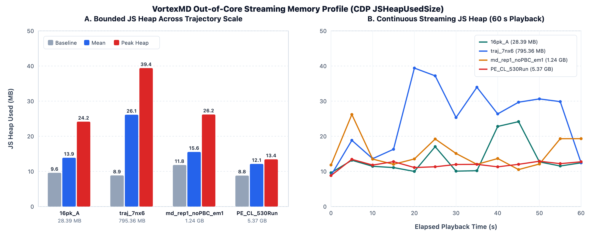
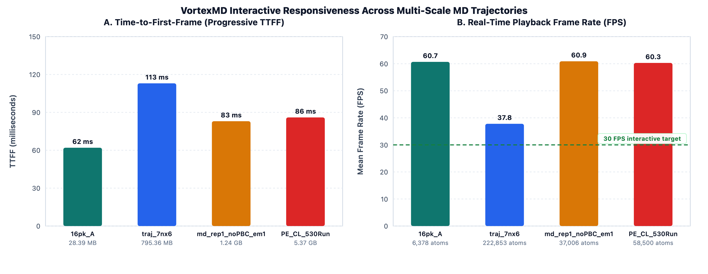
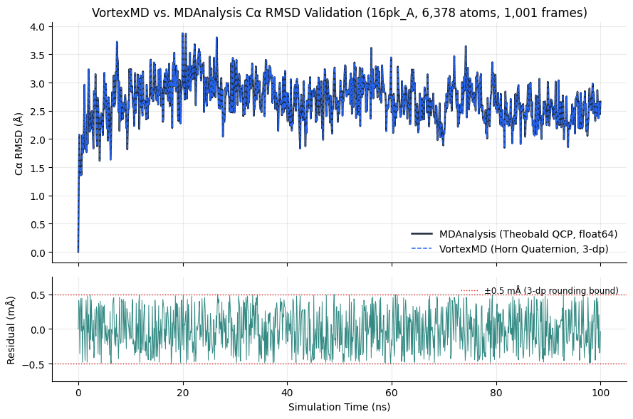
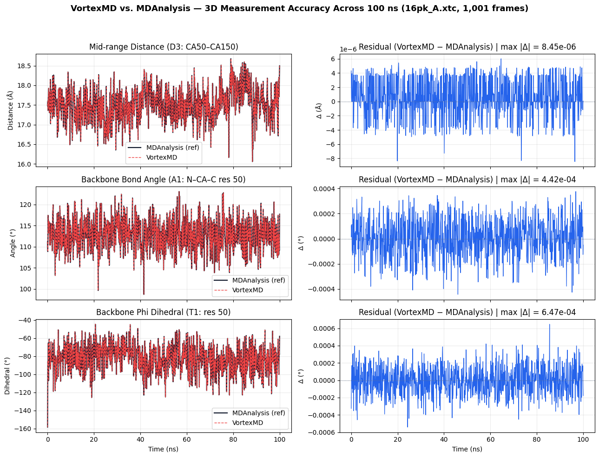

# VortexMD: Serverless Out-of-Core Molecular Dynamics Trajectory Exploration in the Browser

**Syed Mohammad Lokman\***

AUW Antimicrobial Research Center (AARC), Asian University for Women, Chittagong, Bangladesh

\*Corresponding author: `syed.lokman@auw.edu.bd`

---

## Abstract

Interactive inspection of multi-gigabyte molecular dynamics (MD) trajectories inside web browsers is typically bottlenecked by JavaScript heap ceilings, main-thread parsing freezes, or the need to maintain dedicated trajectory-streaming servers. Here we present **VortexMD** (*Virtual Out-of-core Ring-buffered Trajectory EXplorer for Molecular Dynamics*), an open-source, zero-backend Progressive Web App (PWA) for real-time visualization and quantitative analysis of large GROMACS (`.xtc`) trajectories directly on client hardware. Built atop NGL Viewer v2.4.0 for WebGL molecular graphics while replacing its in-memory trajectory loader with header-only binary indexing, IndexedDB offset caching, multi-threaded Web Workers, and an adaptive sliding ring buffer, VortexMD streams trajectories up to 5.37 GB within 13.4–39.4 MB of JavaScript heap, reaches first-frame rendering in 62–113 ms, and reproduces MDAnalysis v2.11.0 RMSD and 3D geometric measurements to within $5.00 \times 10^{-4}\text{ Å}$ and $7.18 \times 10^{-4}\text{°}$. VortexMD is freely accessible without login at [https://vortexmd.netlify.app](https://vortexmd.netlify.app) and installable for offline analysis under the GNU AGPLv3 license.

**Keywords:** molecular dynamics, out-of-core streaming, WebGL, browser visualization, GROMACS XTC, RMSD, Progressive Web App

---

## 1. Introduction

Atomistic molecular dynamics (MD) simulations routinely generate multi-gigabyte binary trajectories spanning tens of thousands of frames and hundreds of thousands of atoms. While desktop tools such as VMD, PyMOL, and ChimeraX handle large local files effectively, they require local installation and platform-specific maintenance. Modern browser-based viewers—most notably [NGL Viewer](https://academic.oup.com/bioinformatics/article/34/21/3755/5021685) and [Mol* Viewer](https://academic.oup.com/nar/article/49/W1/W431/6270780)—have transformed structural biology by enabling zero-install WebGL visualization, yet their default local-file workflows decode entire trajectories into browser memory before playback. On commodity laptops (8 GB RAM), loading a 1–5 GB compressed `.xtc` file frequently triggers multi-second UI freezes, multi-gigabyte heap spikes, or out-of-memory tab crashes. Server-assisted streaming architectures mitigate client RAM usage but require continuous backend hosting, expose proprietary trajectories to network upload, and fail offline.

**VortexMD** addresses this gap with a strictly client-side, out-of-core streaming architecture. Rather than rebuilding a WebGL molecular renderer from scratch, VortexMD leverages NGL Viewer (v2.4.0) for static topology loading, molecular representation shaders, and selection grammar while replacing NGL's in-memory trajectory pipeline with header-only `.xtc` binary indexing, IndexedDB offset caching, multi-threaded Web Worker decompression, and an adaptive ring buffer. Alongside fluid WebGL playback, VortexMD provides in-browser closed-form Horn quaternion RMSD alignment, live 3D interatomic distance/angle/dihedral tracking, hierarchical molecular trees, publication-ready image/video export, and portable JSON sessions—packaged as an installable, zero-backend Progressive Web App (PWA).

---

## 2. Materials and Methods

### 2.1 Out-of-Core Streaming and Binary Header Indexing

VortexMD uses **NGL Viewer (v2.4.0)** (`NGL.Stage` and `stage.loadFile`) for static topology parsing (`.pdb`, `.gro`, `.cif`, `.mmtf`, `.mol2`, `.sdf`, `.prmtop`, `.psf`, `.top`) and WebGL molecular rendering, while replacing NGL's default in-memory trajectory loader with a custom out-of-core GROMACS `.xtc` streaming pipeline. Before allocating buffers, `trajectory-validator.js` validates the XTC magic number, confirms atom-count parity against the NGL-loaded topology, and verifies positive simulation box diagonals.

To avoid upfront coordinate decompression, `indexer.js` performs a progressive header-only scan inside Web Workers, reading each frame's compressed payload size to record byte offsets (`fileOffsets`) and physical timestamps (`frameTimes`). Playback unlocks as soon as the initial frame batch is indexed (yielding sub-second time-to-first-frame, TTFF) while the remaining file indexes asynchronously in the background. Verified offset tables are persisted in browser IndexedDB (`index-cache.js`), allowing repeat loads of multi-gigabyte trajectories to bypass indexing.

### 2.2 Adaptive Ring Buffer and Multi-Threaded Web Workers

When uncompressed coordinate storage ($\text{atoms} \times 3 \times 4\text{ bytes} \times \text{frames}$) exceeds the active cache ceiling, `RingBufferManager` (`trajectory.js`) fetches only the active and prefetched frame byte ranges via `File.slice()`, dispatches them to a round-robin pool of Web Workers (`worker-manager.js`, `worker.js`), decompresses them with `headless-xtc.js` (a zero-DOM pure-JavaScript 3dfx XTC decoder adapted from GROMACS `xdrfile.c` and NGL's `XtcParser` for chunked worker execution), and evicts distant frames automatically.

`memory-budget.js` selects the RAM cache budget adaptively using `navigator.deviceMemory` and device class: **500 MB** ($\ge 8\text{ GB}$ RAM), **250 MB** (4–8 GB RAM or desktop fallback when browser privacy settings mask RAM), **100 MB** (2–4 GB RAM), and **50 MB** ($< 2\text{ GB}$ RAM or mobile). VortexMD bridges its ring buffer into NGL's rendering layer via `NGL.CallbackTrajectory`, `NGL.Signal`, and `NGL.Counter`, updating atomic position arrays in place (`structure.updatePosition` / `comp.updateRepresentations`) under a unified 30 FPS base physics clock (`playback.js`):

$$\text{framesToAdvance} = \frac{\Delta t_{\text{clamped}}}{1000} \times 30 \times \text{speedMultiplier} \times \text{frameStep} \times \text{dirSign}$$

where optional Catmull-Rom spline interpolation provides smooth 60 FPS sub-frame motion.

### 2.3 Structural Analysis: Horn Quaternion RMSD and 3D Geometry

* **Closed-Form RMSD Alignment (`analytics.js`, `rmsd.js`):** Atom indices for independent **Fit** and **Calc** groups are resolved via `NGL.Selection` (e.g., `protein and .CA`, `[ATP]`), while rigid-body superposition against Frame 0 is implemented natively in VortexMD using [Horn's closed-form unit-quaternion method](https://web.stanford.edu/class/cs273/refs/Absolute-OPT.pdf) (cyclic Jacobi eigen-decomposition of the $4 \times 4$ symmetric Davenport key matrix). Automatic stride capping ($\le 2,500$ points) or manual stride executes off-thread in worker batches (25 frames/batch, max concurrency 2) and plots onto an interactive zoom/seek canvas chart with multi-run comparison and CSV export.
* **3D Interatomic Measurements (`measurement.js`):** Visual 3D overlays (dashed lines, arcs, and labels) use NGL measurement representations (`NGL.setMeasurementDefaultParams`) and vector/box primitives (`NGL.Vector3`, `NGL.Box3`), while all numerical Euclidean distances (Å), planar valence angles ($0\text{–}180\text{°}$), and signed IUPAC dihedral torsions ($-180\text{°}$ to $+180\text{°}$) are computed in 64-bit floating-point precision by VortexMD's `InteractionManager`, updated live during playback and spline interpolation, and exported as CSV or JSON.

### 2.4 Modular Architecture, NGL Integration Scope, and Offline PWA

VortexMD enforces a strict three-layer architecture verified by 10 automated static boundary rules (`scripts/check-boundaries.mjs`) and 136 unit/integration tests (`vitest`):

1. **Contracts (`src/contracts/`):** Zero-import frozen `PUBLIC_API` and `EVENTS` specifications.
2. **Engine (`src/engine/`):** Headless-capable `<vortexmd-engine>` custom HTML element operating inside an open Shadow DOM root (`#viewport`), wrapping NGL Viewer v2.4.0 for WebGL rendering, camera transforms (`NGL.Matrix4`), representations, and high-resolution image capture (`stage.makeImage`) while owning all out-of-core streaming, worker, analysis, and session logic.
3. **Presentation (`src/ui/`):** Zero-framework web shell (Tailwind CSS v4, Lucide icons, native `<dialog>`/Popover API) where each UI panel mounts inside an error boundary (`mountPanel`, isolating faults at 5 errors / 10 s).

To keep software provenance transparent, **Table 1** summarizes which components are reused or adapted from NGL Viewer v2.4.0 versus engineered specifically for VortexMD. The production build (`vite-plugin-pwa`, Workbox `autoUpdate`) generates a standalone installable PWA (`display: standalone`) that precaches the app shell and bundled demo topology for offline launch while routing remote trajectory requests as `NetworkOnly`, enabling fully offline local trajectory analysis after initial load. Workspace state (camera matrices, molecular tree styles, custom NGL selections, measurements, A/B loop bounds, timeline pins, and cached offsets) serializes to zero-cloud `.json` session files with a sandbox-compliant local file Re-Link dialog.

**Table 1.** Attribution of NGL Viewer (v2.4.0) Components Versus Custom VortexMD Subsystems

| Subsystem | Reused / Adapted from NGL Viewer (v2.4.0) | Engineered in VortexMD |
| :--- | :--- | :--- |
| **WebGL Rendering & Topology** | `NGL.Stage`, `stage.loadFile`, molecular shaders (`cartoon`, `licorice`, `surface`, etc.), `NGL.Matrix4` camera, `stage.makeImage` | Shadow DOM `<vortexmd-engine>`, PyMOL/Coot/WebGL mouse presets, adaptive playback quality, opaque 300 DPI / 4K & WebM/MP4 export orchestration |
| **Trajectory Streaming** | `NGL.CallbackTrajectory`, `NGL.Signal`, `NGL.Counter`; XTC 3dfx bit-decoding adapted from GROMACS `xdrfile.c` & NGL `XtcParser` | Header-only binary indexer (`indexer.js`), IndexedDB offset cache (`index-cache.js`), pre-flight validator, adaptive 50–500 MB ring buffer, Web Worker pool, unified 30 FPS clock |
| **Selections & Analysis** | `NGL.Selection` query parser; NGL 3D measurement visual overlays (`NGL.setMeasurementDefaultParams`, `NGL.Vector3`, `NGL.Box3`) | Closed-form Horn quaternion RMSD worker pipeline (`analytics.js`, `rmsd.js`), 64-bit live distance/angle/dihedral math (`measurement.js`), auto-grouped molecular tree |
| **Workspace & Delivery** | — | Zero-cloud `.json` sessions with sandbox file Re-Link, timeline pins & A/B looping, fault-isolated UI panels, offline PWA (`vite-plugin-pwa`) |

### 2.5 Trajectory Pre-Processing Assumptions

Consistent with established viewers such as PyMOL and Mol*, VortexMD does not perform on-the-fly periodic boundary condition (PBC) unwrapping. Loaded trajectories are assumed to be post-processed (e.g., via GROMACS `gmx trjconv -pbc mol` or MDAnalysis) to ensure PBC wrapping, center-of-mass centering, and monotonically increasing timestamp/step metadata across concatenated runs.

### 2.6 Validation and Benchmarking Protocols

* **Multi-System Runtime Benchmark:** Evaluated on an Apple M1 MacBook Air (8 GB RAM, macOS `darwin-arm64`) running Headless Chromium 156.0.8078.4 (Metal ANGLE) via Chrome DevTools Protocol (CDP) `Performance.getMetrics` (`JSHeapUsedSize`) and `<vortexmd-engine>.getPerformanceMetrics()`. Four publicly available trajectories spanning 28.39 MB to 5.37 GB were tested in isolated browser contexts (`browser.newContext()`) over 60 s continuous looping playback sampled at 5 s intervals (`scripts/run-benchmark-offline.mjs`).
* **Head-to-Head Browser Comparison:** Evaluated against Mol* and Native NGL on the 1.24 GB Chalcone protein–drug trajectory (`md_rep1_noPBC_em1`, 37,006 atoms) using browser DevTools console telemetry (`scripts/console-head-to-head-benchmark.js`) measuring TTFF, full parse duration, main-thread UI lockups (>50 ms stalls), peak JS heap, and mean playback FPS.
* **Numerical Validation:** Head-to-head parity of `headless-xtc.js`, `hornSuperpose`, and `calcDistance`/`calcAngle`/`calcDihedral` was verified against [MDAnalysis v2.11.0](https://proceedings.scipy.org/articles/Majora-629e541a-00e) (`xdrfile`, [Theobald QCP](https://journals.iucr.org/10.1107/S0108767305015266/full), and `MDAnalysis.lib.distances`) across all 1,001 frames of `16pk_A` (6,378 atoms, 100 ns, $\Delta t = 100\text{ ps}$) and 100 frames of `demo.xtc`.

---

## 3. Results

### 3.1 Multi-System Memory and Responsiveness Scaling

Across four biomolecular archetypes spanning nearly three orders of magnitude in file size (28.39 MB to 5.37 GB) and up to 222,853 atoms, VortexMD maintained a flat JavaScript heap footprint between **13.44 MB and 39.41 MB** peak (Table 2, Figure 1). Progressive streaming rendered Frame 1 in **62–113 ms** regardless of file size, while background binary indexing completed in **0.02–3.42 s** (Figure 2). Interactive playback sustained **60.3–60.9 FPS** on monomeric protein, protein–drug, and 5.37 GB membrane bilayer systems, and **37.8 FPS** on the 222,853-atom SARS-CoV-2 RBD–Fab complex—exceeding the 30 FPS interactive threshold across all tested systems.

**Table 2.** Multi-System Empirical Runtime Performance of VortexMD Across Representative Biomolecular Archetypes$^a$

| Biological System | Archetype | Atoms | Frames | File Size | Progressive TTFF$^b$ | Full XTC Index | Baseline Heap | Peak Heap | Mean Heap | Heap Delta | Mean FPS |
| :--- | :--- | ---: | ---: | ---: | ---: | ---: | ---: | ---: | ---: | ---: | ---: |
| **PGK (`16pk_A`)** | Monomeric protein | 6,378 | 1,001 | 28.39 MB | 62 ms | 0.02 s | 9.61 MB | 24.16 MB | 13.89 MB | 14.54 MB | 60.7 FPS |
| **SARS-CoV-2 RBD–Fab (`traj_7nx6`)** | Antigen–antibody complex | 222,853 | 110 | 795.36 MB | 113 ms | 3.36 s | 8.86 MB | 39.41 MB | 26.14 MB | 30.55 MB | 37.8 FPS |
| **Chalcone Complex (`md_rep1_noPBC_em1`)** | Protein–drug complex | 37,006 | 10,001 | 1.24 GB | 83 ms | 0.47 s | 11.84 MB | 26.20 MB | 15.55 MB | 14.36 MB | 60.9 FPS |
| **PE/CL Bilayer (`PE_CL_530Run`)** | Lipid membrane bilayer | 58,500 | 26,501 | 5.37 GB | 86 ms | 3.42 s | 8.82 MB | 13.44 MB | 12.14 MB | 4.62 MB | 60.3 FPS |

$^a$Measured via automated CDP telemetry on an Apple M1 MacBook Air (8 GB RAM, macOS `darwin-arm64`, Headless Chromium 156.0.8078.4, 60 s continuous playback sampled every 5 s).  
$^b$Time-to-First-Frame (TTFF): elapsed time from local file injection to decoded WebGL rendering of Frame 1.

**Figure 1.** Out-of-core JS heap scaling (`JSHeapUsedSize`) across four MD trajectories from 28.39 MB to 5.37 GB. **(A)** Baseline, mean, and peak heap usage remain below 40 MB regardless of trajectory size. **(B)** Continuous 60 s playback time series showing flat, leak-free memory occupancy under ring-buffer eviction.

**Figure 2.** Interactive responsiveness across multi-scale trajectories. **(A)** Progressive Time-to-First-Frame (62–113 ms). **(B)** Mean playback frame rate exceeding the 30 FPS interactive target on all four systems.

### 3.2 Head-to-Head Comparison Against In-Memory Web Viewers

On the 1.24 GB Chalcone protein–drug trajectory (37,006 atoms), in-memory browser viewers required full binary decompression before rendering Frame 1, consuming over **5.5 GB** of JS heap and inducing **23.37–33.60 s** of continuous main-thread UI lockup (Table 3). In contrast, VortexMD reduced peak JS heap by **>210×** (26.20 MB vs. 5,968.1 MB in Mol* and 5,525.1 MB in Native NGL), achieved sub-100 ms TTFF (0.08 s), completed full binary indexing in 0.47 s, and sustained 60.9 FPS playback.

**Table 3.** Head-to-Head Performance Comparison on a 1.24 GB Production Trajectory (Chalcone Complex, 37,006 Atoms)$^a$

| Visualization Tool | Traj. Size | TTFF (s)$^b$ | Full Parse / Index Time | Max UI Lockup$^c$ | Total Frozen Time | Peak JS Heap | Mean FPS |
| :--- | ---: | ---: | ---: | ---: | ---: | ---: | ---: |
| **Mol\*** | 1.24 GB | N/A | 138.97 s | 23.37 s | 45.95 s | 5,968.1 MB | 36.4 FPS |
| **Native NGL** | 1.24 GB | N/A | N/A | 33.60 s | 49.73 s | 5,525.1 MB | 58.1 FPS |
| **VortexMD (v1.0)**$^d$ | 1.24 GB | 0.08 s | 0.47 s | 2.42 s | 2.40 s | 26.20 MB | 60.9 FPS |

$^a$Measured on an Apple M1 MacBook Air (8 GB RAM) using browser console telemetry (`scripts/console-head-to-head-benchmark.js`).  
$^b$In-memory visualizers cannot render Frame 1 until the entire binary trajectory is decompressed and allocated.  
$^c$Longest continuous interval during which the JavaScript main-thread event loop was blocked (>50 ms threshold).  
$^d$TTFF (83 ms), full XTC index (0.47 s), peak heap (26.20 MB), and mean FPS (60.9 FPS) reflect latest v1.0 CDP measurements; main-thread lockup figures reflect prior console-harness profiling and can be re-verified on live deployments using `scripts/console-head-to-head-benchmark.js`.

### 3.3 Numerical Accuracy Validation Against MDAnalysis

Head-to-head comparison against MDAnalysis v2.11.0 across 1,001 frames of `16pk_A` (100 ns) and 100 frames of `demo.xtc` confirmed numerical equivalence across coordinate decompression, RMSD superposition, and 3D geometric calculations (Table 4, Figures 3–4). XTC decompression parity (`headless-xtc.js` vs. `xdrfile`) showed a maximum coordinate deviation of $7.63 \times 10^{-6}\text{ Å}$. Across all RMSD alignment modes—including decoupled Fit (`Cα`) / Calc (all-atom) selections—maximum absolute deviation remained $\le 5.00 \times 10^{-4}\text{ Å}$ (RMSE $\le 2.89 \times 10^{-4}\text{ Å}$, Pearson $r \ge 0.999999665$), with **0 frames differing** after 3-decimal rounding. Across 10,010 evaluated 3D measurement pairs (4 distances, 3 angles, 3 dihedrals × 1,001 frames), maximum deviations were $\le 1.00 \times 10^{-5}\text{ Å}$ for distances, $\le 7.18 \times 10^{-4}\text{°}$ for angles, and $\le 6.47 \times 10^{-4}\text{°}$ for signed IUPAC dihedrals ($r \ge 0.999999997$, exact sign parity).

**Table 4.** Numerical Parity of VortexMD Against MDAnalysis v2.11.0 (`16pk_A`, 6,378 Atoms, 1,001 Frames, 100 ns)

| Validation Metric | VortexMD Routine | MDAnalysis Reference | Max $|\Delta|$ (Raw) | RMSE (Raw) | Pearson $r$ |
| :--- | :--- | :--- | ---: | ---: | ---: |
| **XTC Coordinates** | `headless-xtc.js` | `xdrfile` | $7.63 \times 10^{-6}\text{ Å}$ | — | $1.000000000$ |
| **RMSD ($C_\alpha$ fit / $C_\alpha$ calc)** | `hornSuperpose` | Theobald QCP | $5.00 \times 10^{-4}\text{ Å}$ | $2.86 \times 10^{-4}\text{ Å}$ | $0.999999717$ |
| **RMSD (Backbone N,CA,C,O)** | `hornSuperpose` | Theobald QCP | $4.99 \times 10^{-4}\text{ Å}$ | $2.88 \times 10^{-4}\text{ Å}$ | $0.999999712$ |
| **RMSD (All-atom, 6,378)** | `hornSuperpose` | Theobald QCP | $5.00 \times 10^{-4}\text{ Å}$ | $2.88 \times 10^{-4}\text{ Å}$ | $0.999999667$ |
| **RMSD (Fit $C_\alpha$ / Calc All)** | `hornSuperpose` | Theobald QCP | $5.00 \times 10^{-4}\text{ Å}$ | $2.89 \times 10^{-4}\text{ Å}$ | $0.999999665$ |
| **3D Distances (4 pairs)** | `calcDistance` | `calc_bonds` | $\le 1.00 \times 10^{-5}\text{ Å}$ | $\le 3.00 \times 10^{-6}\text{ Å}$ | $\ge 0.999999997$ |
| **3D Angles (3 triplets)** | `calcAngle` | `calc_angles` | $\le 7.18 \times 10^{-4}\text{°}$ | $\le 1.90 \times 10^{-4}\text{°}$ | $\ge 0.999999998$ |
| **3D Dihedrals (3 quadruplets)** | `calcDihedral` | `calc_dihedrals` | $\le 6.47 \times 10^{-4}\text{°}$ | $\le 1.64 \times 10^{-4}\text{°}$ | $1.000000000$ |

**Figure 3.** Numerical validation of VortexMD's Horn quaternion RMSD engine against MDAnalysis (Theobald QCP) across 1,001 frames of `16pk_A`, confirming $\le 5.00 \times 10^{-4}\text{ Å}$ agreement across $C_\alpha$, backbone, all-atom, and decoupled Fit/Calc modes.

**Figure 4.** Frame-by-frame validation of VortexMD's 3D geometric measurement engine against `MDAnalysis.lib.distances` across representative covalent/non-covalent distances, backbone/domain angles, and $\phi/\psi/\omega$ dihedral torsions.

---

## 4. Discussion

Decoupling trajectory indexing from coordinate decompression removes the fundamental memory bottleneck of browser-based MD visualization. Because VortexMD stores only compact byte offsets in IndexedDB and streams active frame slices through Web Workers, memory consumption depends on the ring-buffer window rather than total file size—enabling a 5.37 GB lipid bilayer trajectory to run in 13.44 MB of JS heap on an 8 GB laptop. Residual numerical differences relative to MDAnalysis ($10^{-6}\text{–}10^{-4}$ units) arise strictly from single-precision `Float32` coordinate storage and XTC lossy quantization, confirming that client-side JavaScript analysis matches established Python reference libraries without sacrificing scientific accuracy.

Equally important for long-term community availability is VortexMD's **zero-backend static PWA architecture**. Because all parsing, alignment, and rendering execute locally in the user's browser, hosting at [https://vortexmd.netlify.app](https://vortexmd.netlify.app) requires no cloud compute, database, or backend server maintenance, keeps sensitive pharmaceutical or unpublished trajectories strictly on the user's machine, and remains functional offline once installed. Current limitations are intentional and well-scoped: trajectories must be PBC-wrapped and centered prior to loading, and native binary streaming currently targets GROMACS `.xtc` files (with modular parser routing in `src/engine/parser-router.js` designed to support additional binary formats such as DCD or TRR in future releases).

---

## 5. Conclusions

VortexMD demonstrates that multi-gigabyte molecular dynamics trajectories can be explored, aligned, and quantitatively measured interactively inside standard web browsers without server infrastructure or memory exhaustion. By uniting out-of-core `.xtc` header indexing, adaptive ring-buffered Web Worker streaming, validated Horn quaternion RMSD and 3D geometry engines, and installable offline PWA delivery atop NGL Viewer's WebGL graphics foundation, VortexMD lowers the barrier to reproducible, zero-install trajectory inspection across research and teaching environments.

---

## 6. Data and Software Availability

* **Live Web Application (Anonymous Access):** [https://vortexmd.netlify.app](https://vortexmd.netlify.app) (no login or registration required; installable offline PWA).
* **Hosting Sustainability Statement:** VortexMD is a 100% client-side static web application with zero backend infrastructure or recurring compute costs. It is hosted on static edge infrastructure (Netlify) and can be freely redeployed from source on any static host (GitHub Pages, Netlify, Cloudflare Pages) or run locally via `npm install && npm run dev`.
* **Source Code & Archival Release:** Open-source under the **GNU Affero General Public License v3.0 (GNU AGPLv3)** at [https://github.com/vortexmd/vortexmd](https://github.com/vortexmd/vortexmd) *(Zenodo archival DOI for v1.0.0 to be minted upon repository release)*.
* **Public Benchmark Datasets:** All external trajectory datasets analyzed in this work are publicly available from open repositories:
  * **`16pk_A` (Phosphoglycerate kinase):** [ATLAS Database of Biomolecular Simulations](https://www.dsimb.inserm.fr/ATLAS/database/ATLAS/16pk_A/16pk_A.html).
  * **Chalcone Protein–Drug Complex (`md_rep1_noPBC_em1`):** Zenodo, DOI: `10.5281/zenodo.21475591`.
  * **PE/CL Lipid Bilayer (`PE_CL_530Run`):** Zenodo, DOI: `10.5281/zenodo.13984201`.
  * **SARS-CoV-2 RBD–Fab (`traj_7nx6`):** Zenodo, DOI: `10.5281/zenodo.5111905`.
* **Validation Notebooks & Benchmark Scripts:** Executed MDAnalysis validation notebooks and frame-by-frame CSVs are included in `validation/` (`validation/rmsd/` and `validation/measurements/`); automated CDP and browser-console benchmark harnesses are included in `scripts/`.

---

## 7. Supporting Information

* `VortexMD_vs_MDAnalysis_RMSD_Validation.ipynb`: Executed Jupyter notebook validating XTC coordinate parity and Horn quaternion RMSD against MDAnalysis v2.11.0.
* `VortexMD_vs_MDAnalysis_Measurement_Validation.ipynb`: Executed Jupyter notebook validating 3D interatomic distances, angles, and signed dihedrals against MDAnalysis v2.11.0.
* `benchmark-multi-system-summary.csv` and `benchmark-multi-system-timeseries.csv`: Raw multi-system CDP memory, TTFF, and frame-rate benchmark tables.
* `console-head-to-head-benchmark.js`: Browser DevTools console script for reproducing head-to-head viewer telemetry.

---

## 8. Acknowledgments

The author gratefully acknowledges **Professor Haseena Khan**, Director of the AUW Antimicrobial Research Center (AARC), Asian University for Women, Chittagong, Bangladesh, for her continuous support, guidance, and encouragement throughout this project.

---

## References

1. Rose, A. S.; Bradley, A. R.; Valasatava, Y.; Duarte, J. M.; Prlić, A.; Rose, P. W. NGL Viewer: Web-Based Molecular Graphics for Large Complexes. *Bioinformatics* **2018**, *34* (21), 3755–3758. DOI: [10.1093/bioinformatics/bty419](https://academic.oup.com/bioinformatics/article/34/21/3755/5021685).
2. Sehnal, D.; Bittrich, S.; Deshpande, M.; Svobodová, R.; Berka, K.; Bazgier, V.; Velankar, S.; Burley, S. K.; Koča, J.; Rose, A. S. Mol* Viewer: Modern Web App for 3D Visualization and Analysis of Large Biomolecular Structures. *Nucleic Acids Res.* **2021**, *49* (W1), W431–W437. DOI: [10.1093/nar/gkab314](https://academic.oup.com/nar/article/49/W1/W431/6270780).
3. Horn, B. K. P. Closed-Form Solution of Absolute Orientation Using Unit Quaternions. *J. Opt. Soc. Am. A* **1987**, *4* (4), 629–642. [PDF](https://web.stanford.edu/class/cs273/refs/Absolute-OPT.pdf).
4. Theobald, D. L. Rapid Calculation of RMSDs Using a Quaternion-Based Characteristic Polynomial. *Acta Crystallogr., Sect. A* **2005**, *61* (4), 478–480. DOI: [10.1107/S0108767305015266](https://journals.iucr.org/10.1107/S0108767305015266/full).
5. Gowers, R. J.; Linke, M.; Barnoud, J.; Reddy, T. J. E.; Melo, M. N.; Seyler, S. L.; Domański, J.; Dotson, D. L.; Buchoux, S.; Kenney, I. M.; Beckstein, O. MDAnalysis: A Python Package for the Rapid Analysis of Molecular Dynamics Simulations. *Proc. 15th Python in Science Conf. (SciPy 2016)* **2016**, 98–105. [Proceedings](https://proceedings.scipy.org/articles/Majora-629e541a-00e).
6. Michaud-Agrawal, N.; Denning, E. J.; Woolf, T. B.; Beckstein, O. MDAnalysis: A Toolkit for the Analysis of Molecular Dynamics Simulations. *J. Comput. Chem.* **2011**, *32* (10), 2319–2327. DOI: `10.1002/jcc.21787` ([MDAnalysis Citations](https://docs.mdanalysis.org/2.12.0-dev0/documentation_pages/references.html)).
7. Vander Meersche, Y.; Cretin, G.; Gheeraert, A.; Gelly, J.-C.; Galochkina, T. ATLAS: Protein Flexibility Description from Atomistic Molecular Dynamics Simulations. *Nucleic Acids Res.* **2024**, *52* (D1), D384–D392. [Article](https://academic.oup.com/nar/article/52/D1/D384/7438909).
